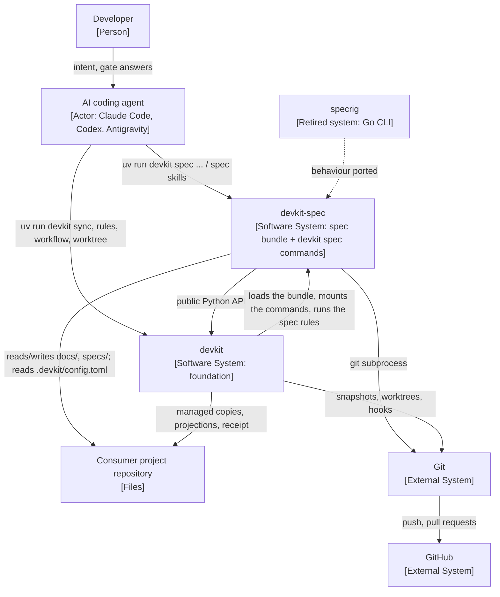

# [ARCH-03-context] System Scope and Context

- **arc42**: §3 System Scope and Context / C4 Model Level 1 (System Context)
- Background, goals and stakeholders reside in `ARCH-01-introduction-and-goals`.

---

## 1. C4 Level 1: System Context Diagram

---

## 2. Boundary with devkit

devkit is the SDD-agnostic foundation; devkit-spec owns everything spec-driven. The split is a hard boundary
(`ADR-rebuild-specrig-on-devkit`):

| devkit owns (used through its public surface) | devkit-spec owns |
| :--- | :--- |
| Distribution: bundles, presets, `devkit sync`, `add`, `remove`, `status`, managed copies, agent projections, the receipt, overrides, `devkit get-context` | The `spec` bundle's content: constitution, instructions, guidance pointer, skills, role contracts, playbooks, templates, docs skeleton (`CAP-HARN-agent-guidance`) |
| Rule engine: `devkit rules check`, `fix`, `explain`, targeting, Git snapshot runs, the built-in `RULE-markdown-link` and `RULE-file-length` | The spec rules and their guides (`CAP-GOV-spec-rules`, `CAP-TRACE-code-entrypoints`) |
| Workflow engine: definitions, bindings, `devkit workflow next`, `show`, `answer`, `envelope`, approval gates and their policy | The four delivery workflows, their stages and check mapping (`CAP-DLV-delivery-workflows`) |
| Commit gate: hook wrappers, the `rules-check` and `verify-commands` gates | Nothing; `rules-check` evaluates the staged tree as `devkit rules check --staged` does, which runs the spec rules |
| Search: lexical, dense and hybrid ranking (`devkit.search`, `devkit[search]`) | The search policy: candidates, fields, pinning, glossary (`CAP-DOCS-document-search`) |
| Worktrees: `devkit worktree start`, `finish`, `status` | When routes run in a worktree (`[tool.spec] worktree`, `auto` or `required`) and the work-scope registry (`CAP-COLL-work-scope-registry`) |
| Agent Advisory Protocol and output helpers (`devkit.advisory`, `devkit.core.cli`) | The `SPEC_` codes (`ARCH-08-cross-cutting`) |
| Command plugins (`devkit.commands`) | The `devkit spec` group (`CAP-HARN-command-mount`) |

A generic capability devkit-spec needs is added to devkit first and used through its public surface; devkit-spec
never imports devkit's private helpers or copies them.

---

## 3. External System Interfaces

| External System | Protocol | Data Format | Integration Purpose | Fallback Strategy |
| :--- | :--- | :--- | :--- | :--- |
| **devkit** (`devkit>=0.1,<0.2`) | Python imports; entry points `devkit.bundles`, `devkit.commands` and `devkit.post_finish` | Python objects, bundle manifest (`bundle.toml`) | Host process and engines: devkit imports `devkit_spec` to locate the bundle and the command group | An unusable plugin fails only `devkit spec`, with devkit's `COMMAND_PLUGIN_INVALID`; every other `devkit` command keeps working |
| **AI coding agent hosts** (`claude-code`, `codex`, `antigravity`) | Shell or tool calls; projected skill and subagent files | stdout sentinels or JSON, stderr advisory blocks | The agent is the primary consumer of the commands and skills | A host without native subagents runs a role's procedure in the main session (every role is optional) |
| **Consumer project** | File system | Markdown with YAML frontmatter, TOML (`.devkit/config.toml`), YAML (`docs/glossary.yaml`) | The Living Spec, feature specs, proposals and policy | An unreadable document is left out of the index with a `SPEC_DOCUMENT_INVALID` warning |
| **Git** | Subprocess (`devkit.core.run_git`) | Porcelain output | Snapshots (devkit), observed scope paths, the Git common and per-worktree directories, base revisions and base branches | Git failures surface as devkit's `GIT_FAILED`; scope commands bound every Git call by a deadline (`SPEC_SCOPE_TIMEOUT`) |
| **GitHub** | Git over HTTPS or SSH; pull requests | - | Hosting; pull request integration under `[worktree] pull_request = "required"`, or when a task needs it under `"auto"` | Integration without pull requests: `devkit worktree finish --merge` |
| **Embedding model** (`devkit-embed`, through `devkit-spec[search]`) | Python import through devkit | float16 static embeddings | Dense and hybrid search | `--mode auto` ranks lexically when the extra is absent |
| **specrig** (private `mjkimR/specrig`) | None at runtime | - | The Go predecessor whose behaviour was ported; a reference for semantics only | Not a runtime dependency ([specrig port map](../development/specrig-port-map.md)) |
