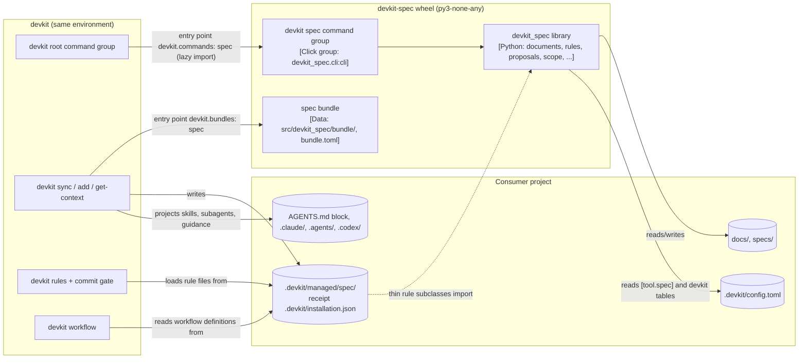

# [ARCH-05-1-containers] Containers View

- **arc42**: §5 Building Block View, Level 1 / C4 Model Level 2 (Container)
- Inside the library: `ARCH-05-2-components`. Installation and environments: `ARCH-07-deployment`.

---

## 1. C4 Level 2: Container Diagram

---

## 2. Container Inventory

One package (`devkit-spec`, `src/devkit_spec/`) ships three parts. The wheel declares no console script.

| Container | Role & Responsibilities | Entry Point | Reaches the Project Through |
| :--- | :--- | :--- | :--- |
| **`spec` bundle** (`src/devkit_spec/bundle/`) | The methodology as agent assets: constitution (`AGENTS.md`), instructions, guidance pointer, 13 `spec*` skills, five role contracts, four workflows, ten rule files with guides, templates, two playbooks, the docs skeleton | `devkit.bundles`: `spec = "devkit_spec"` | `devkit sync`: managed copies, projected skills and subagents, seeded files, the guidance fragment in the `AGENTS.md` block, rules, workflows; recorded in `.devkit/installation.json` |
| **`devkit spec` command group** (`src/devkit_spec/cli/`) | `resolve`, `refs`, `list`, `search`, `new`, `proposal`, `entrypoints`, `scope`, `policy`, `--version` (`CAP-HARN-command-mount`) | `devkit.commands`: `spec = "devkit_spec.cli:cli"` | devkit's root group, which imports the module only when `devkit spec` runs ([Command Plugins](https://github.com/mjkimR/devkit/blob/main/docs/architecture/command-plugins.md)) |
| **`devkit_spec` library** (`src/devkit_spec/`) | The document model, rule implementations, proposal and spec bundle writers, entrypoints, the scope registry, search policy, configuration and errors (`ARCH-05-2-components`) | Python imports | Imported by the command group and by the deployed rule files; importing `devkit_spec` has no side effects |

### 2.1 Bundle Presets

| Preset | Assets | Selection |
| :--- | :--- | :--- |
| `core` (default) | Everything except the docs skeleton | Deployed on the next `devkit sync` after installation, because the bundle declares `auto_select`; a project opts out with `[presets] spec = false` |
| `docs-skeleton` | The seeded `docs/` tree (Living Spec directories, arc42 chapters, glossary, search synonyms) | Opt-in: `devkit add spec:docs-skeleton` (`ADR-docs-skeleton-is-opt-in`) |

The asset inventory and what each asset is for: `CAP-HARN-agent-guidance`.

---

## 3. Inter-Container Communication & Contracts

- **devkit root group to the command group**: devkit resolves `spec` through `devkit.commands` only when the command
  is not built in, imports `devkit_spec.cli`, and runs the group inside its own error boundary. Commands are built on
  `devkit.core.cli` (`boundary`, `FORMAT_OPTION`, `workspace_option`, `echo_json`) and keep devkit's output contract
  (`ADR-mount-under-the-devkit-command-line`).
- **devkit sync to the bundle**: devkit imports `devkit_spec` to locate `bundle/bundle.toml` and copies the selected
  presets' assets into `.devkit/managed/spec/` (Git-ignored), projects skills and role contracts into each agent's
  directories, writes the `spec-pointer` guidance into the `DEVKIT:START/END` block of `AGENTS.md` and seeds the
  docs skeleton once where absent. `devkit get-context spec` returns the constitution with the instructions' read
  conditions.
- **devkit rules to the library**: each deployed rule file `.devkit/managed/spec/rules/<name>/rule.py` subclasses the
  rule class of `devkit_spec.rules`; `devkit rules` instantiates that subclass and `devkit rules explain` prints the
  `guide.md` beside it (`ADR-rules-implemented-in-the-package`). The package therefore has to be installed in the
  environment that runs `devkit rules`.
- **devkit workflow to the bundle**: the workflow definitions are synchronized assets; `devkit workflow next`,
  `show` and `answer` evaluate them. devkit-spec binds new units through `devkit.workflow` (`Workspace`,
  `write_binding`) when `devkit spec new` or `devkit spec proposal new|handoff` creates them.
- **Library to the project**: the library reads and writes Markdown under `docs/` and `specs/` and reads
  `.devkit/config.toml` (`[tool.spec]` and devkit's tables, `ADR-policy-in-the-tool-spec-table`). The work-scope
  registry lives outside the working tree, in the Git common directory (`ARCH-07-deployment`).
