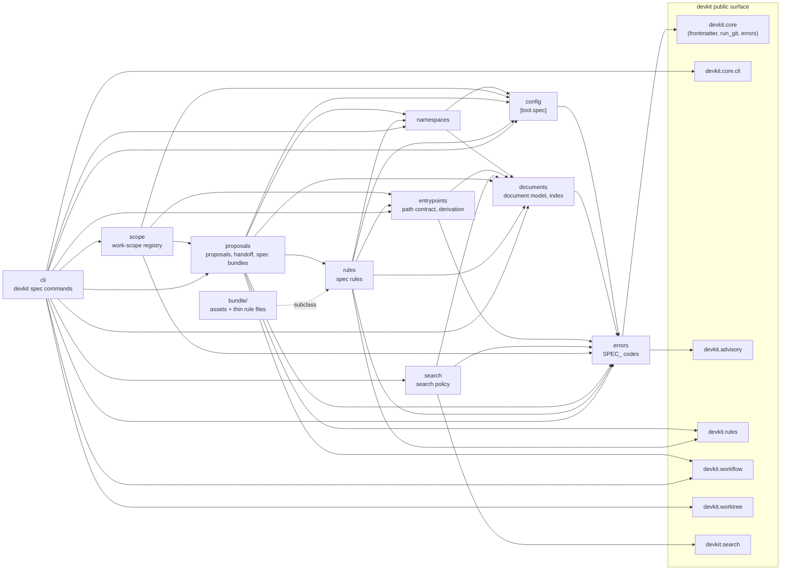

# [ARCH-05-2-components] Components View

- **arc42**: §5 Building Block View, Level 2 / C4 Model Level 3 (Component)
- The containers these components live in: `ARCH-05-1-containers`.

---

## 1. C4 Level 3: Component Diagram

Arrows point from a component to what it imports. devkit modules are shown on the right.



---

## 2. Component Inventory

| Component | Responsibility | Capability |
| :--- | :--- | :--- |
| **`documents`** (`ids`, `model`, `parse`, `markdown`, `index`, `rewrite`) | The ID grammar and kinds, frontmatter and prose references, the Markdown scanner that hides code and comments, the workspace index rebuilt from the files on every load, in-place reference rewriting | `CAP-DOCS-document-model`, `CAP-DOCS-document-lookup` |
| **`namespaces`** | Monorepo namespaces (`[[tool.spec.namespaces]]`): membership, selection from options or the current directory, namespace docs roots | `CAP-DOCS-namespaces` |
| **`search`** | The search policy on devkit's ranking: candidates, ID and summary as embedded metadata, pinning, `docs/glossary.yaml` expansion | `CAP-DOCS-document-search` |
| **`rules`** | The nine spec rules as `BaseRule` subclasses, the shared `document_index(ctx)` and `namespaces(ctx)` helpers, the targeting and history exclusions | `CAP-GOV-spec-rules`, `CAP-TRACE-code-entrypoints` |
| **`entrypoints`** (`paths`, `bundle`, `derive`, `apply`) | The entrypoint path contract, reading `_Boundary` and `reconcile.md` targets of a spec bundle, deriving document-code pairs, writing chosen ones into frontmatter | `CAP-TRACE-code-entrypoints` |
| **`proposals`** (`scaffold`, `binding`, `body`, `handoff`, `rewrite`, `specs`, `prune`) | Proposal and PADR scaffolding, workflow binding, carrying a proposal body into a spec, handoff with rollback, link and ID rewriting, spec bundle skeletons, pruning empty proposal directories | `CAP-DLV-proposal-incubation`, `CAP-DLV-spec-bundles` |
| **`scope`** (`inputs`, `compare`, `model`, `registry`, `localfs`, `location`, `deadline`, `flow`) | Scope sets from proposals, spec bundles and Git, pairwise comparison, the local file registry with its journal, the registry location and owner token, the per-command deadline, a worktree's register/update/release | `CAP-COLL-work-scope-registry` |
| **`config`** | Reading and validating `[tool.spec]` (`worktree`, `namespaces`, `scope`) | `CAP-DLV-project-policy` |
| **`errors`** | Every `SPEC_` advisory as an `AdvisoryError` subclass with its level and protocol fields | `ARCH-08-cross-cutting` |
| **`cli`** (`documents`, `search`, `specs`, `proposals`, `entrypoints`, `scope`, `policy`, `output`) | The `devkit spec` group: options, sentinel and JSON rendering, the only place that prints | `CAP-HARN-command-mount` |
| **`bundle/`** | The asset sources and `bundle.toml`; `bundle/rules/<name>/rule.py` files only subclass the package's rules, `guide.md` beside each | `CAP-HARN-agent-guidance` |

---

## 3. Dependency Invariants

1. **One direction.** `errors` imports no other devkit-spec module; `config` and `documents` import only `errors`;
   `entrypoints`, `namespaces` and `search` sit on `documents`; `rules` sits on those; `proposals` uses `rules`
   only to validate a `summary` with `RULE-document-summary`'s script check; `scope` uses `proposals` only for the
   proposal layout and slug normalization; `cli` is the top. A lower module never imports `cli`. No test enforces
   this direction; review keeps it.
2. **Libraries never print.** Every module below `cli` returns results with their `notices` and raises
   `AdvisoryError` subclasses; `cli` renders them through `devkit.core.cli` (`ARCH-08-cross-cutting`).
3. **devkit through its public surface only.** Imports come from each devkit module's exports (`devkit.core`,
   `devkit.core.frontmatter`, `devkit.core.cli`, `devkit.core.errors`, `devkit.advisory`, `devkit.rules`,
   `devkit.workflow`, `devkit.worktree`, `devkit.search`), never from private helpers.
4. **No side effects on import.** devkit imports `devkit_spec` to locate the bundle and imports `devkit_spec.cli` only
   when `devkit spec` runs; neither import touches the workspace.
5. **Rules read through the run's cache.** Spec rules read files only through `ctx.cache` (via
   `document_index(ctx)`), so a snapshot run sees the snapshot and a fix is seen by the recheck.

---

## 4. Codebase Directory Mapping

```text
src/devkit_spec/
├── __init__.py      # no side effects: devkit imports it to locate the bundle
├── errors.py        # SPEC_ advisory codes
├── config.py        # [tool.spec]
├── namespaces.py    # monorepo document namespaces
├── search.py        # search policy on devkit.search
├── documents/       # IDs, model, parser, Markdown scanner, index, reference rewrite
├── entrypoints/     # path contract, bundle inputs, derivation, apply
├── rules/           # the spec rules (BaseRule subclasses)
├── proposals/       # proposals, PADRs, handoff, spec bundle skeletons, prune
├── scope/           # work-scope comparison and registry
├── cli/             # the devkit spec group and its commands
└── bundle/          # bundle.toml and asset sources
tests/               # mirrors the packages (documents/, entrypoints/, proposals/, rules/, scope/) plus CLI and package tests
```
