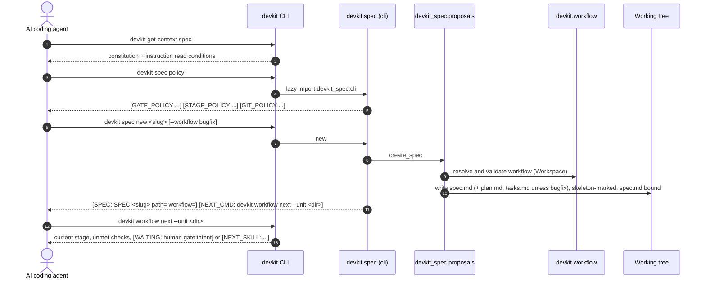
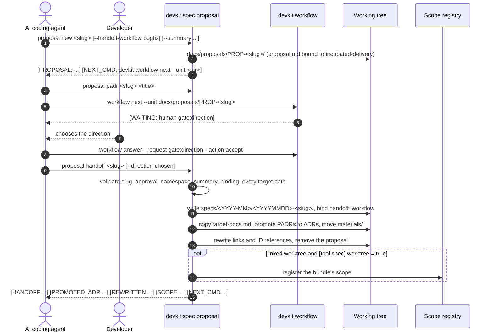
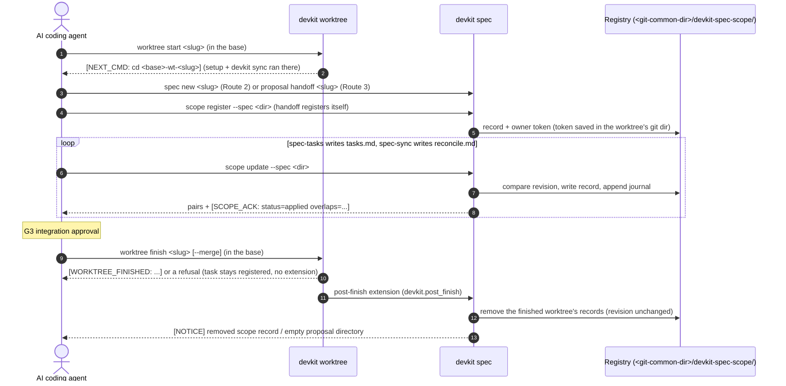

# [ARCH-06-runtime-view] Runtime View

- **arc42**: §6 Runtime View
- Components named here: `ARCH-05-2-components`. Contracts of each command: the capabilities linked per scenario.

---

## 1. Overview

devkit-spec has no long-running process. Every scenario is a sequence of short `devkit` invocations made by the
agent (or by Git hooks and CI), each reading the files afresh. State lives in files: the Living Spec and bundles in
the working tree, workflow bindings and decision records in the unit (devkit's), and the scope registry in the Git
common directory.

---

## 2. Scenario 1: Route 2, from intent to the first stage

The agent routes an intent with the `spec` skill, creates a spec bundle and lets devkit's workflow engine name the
next step (`CAP-DLV-spec-bundles`, `CAP-DLV-delivery-workflows`, `CAP-DLV-project-policy`).



- A missing default workflow leaves `spec.md` unbound with a `SPEC_UNBOUND` notice; an explicit workflow that does not
  resolve fails before anything is written (`SPEC_WORKFLOW_INVALID`).
- Under `ask`, the agent records the user's explicit answer with `devkit workflow answer --unit <dir> --request
  gate:<gate> --action accept`; under `auto` the gate passes by policy (`source=policy`).

---

## 3. Scenario 2: Proposal incubation and handoff

Route 3 and 4 work starts as a proposal bound to `incubated-delivery` and becomes a spec bundle once its direction is
approved (`CAP-DLV-proposal-incubation`, `ADR-handoff-workflow-key`).



- Handoff refuses without approval (`SPEC_PROPOSAL_NOT_APPROVED`): `status: accepted`, or `--direction-chosen` passed
  only when the user explicitly chose the direction.
- A failure while writing the bundle, ADRs or materials removes what was written and keeps the proposal
  (`SPEC_PROPOSAL_HANDOFF_FAILED`); a failed scope registration is a `SPEC_SCOPE_REGISTER_FAILED` warning and the
  handoff stays done.
- devkit's own `devkit workflow handoff` is not used: it rebinds a unit in place and cannot move a proposal bundle
  into the spec layout.

---

## 4. Scenario 3: Commit gate running the spec rules on a snapshot

The commit gate and CI judge exactly what is committed (`CAP-GOV-spec-rules`, `ADR-rules-implemented-in-the-package`).

```mermaid
sequenceDiagram
    autonumber
    actor Agent as AI coding agent
    participant Git
    participant Gate as devkit gate (pre-commit)
    participant Rules as devkit rules
    participant RuleFile as .devkit/managed/spec/rules/<name>/rule.py
    participant Impl as devkit_spec.rules
    participant Index as DocumentIndex

    Agent->>Git: git commit
    Git->>Gate: pre-commit hook
    Gate->>Rules: verify-commands: uv run devkit rules check --staged
    Rules->>Rules: materialize the staged tree; read config, receipt and rule files from it
    Rules->>RuleFile: load rule classes
    RuleFile->>Impl: subclass of the package's rule
    Rules->>Impl: check(ctx) per targeted file (changed files of the diff)
    Impl->>Index: document_index(ctx) through ctx.cache (the snapshot)
    Impl->>Impl: ctx.snapshot: changed and deleted paths, base, mode
    Impl-->>Rules: violations on targeted files
    Rules-->>Gate: exit 1 on errors
    Gate-->>Git: refuse the commit (GATE_VERIFY_FAILED) or let it pass
```

- `RULE-reconcile-contract` requires every `modified` target of a resolved `reconcile.md` changed in the snapshot's
  diff; `RULE-code-entrypoints` also reports current documents declaring a path the diff deletes.
- `devkit rules check --ci --base <ref>` runs the same evaluation on merge-base through HEAD in CI.
- A malformed `[tool.spec]` table fails the run (`SPEC_CONFIG_INVALID`, which devkit keeps with the rule's ID,
  exit `2`) instead of being reported as a violation.

---

## 5. Scenario 4: Worktree lifecycle with the scope registry

Under `[tool.spec] worktree = true`, Route 2, Route 3 and bugfix tasks run in their own worktree; the skills keep the
registry current, and devkit-spec's `devkit.post_finish` extension cleans up after a successful finish
(`CAP-COLL-work-scope-registry`, `ADR-cleanup-after-worktree-finish`).



- `overlaps=` above 0 informs scheduling and integration order; it never blocks work.
- An update that does not apply prints `[SCOPE_ACK: status=failed|stale|timeout ...]` and its error
  (`SPEC_SCOPE_STALE_REVISION`, `SPEC_SCOPE_TIMEOUT`, ...); `--request-id` makes a retry idempotent.
- `devkit spec scope release -w <worktree>` withdraws an abandoned task instead of the sweep.

---

## 6. Concurrency and Delivery Guarantees

1. **Registry operations** hold an exclusive `flock` on `<shared>/<namespace>/.lock` for read, compare and write
   (devkit's `file_lock`), and publish a record by atomic rename (`atomic_write_text`); updates use optimistic
   revisions (`SPEC_SCOPE_STALE_REVISION`).
2. **Writers validate first**: `spec new` and `proposal handoff` check every input and target path before the first
   write and undo their writes on a file system failure; `entrypoints derive --apply` changes only the `entrypoints`
   block of each document and reports a document it cannot write (`SPEC_ENTRYPOINTS_APPLY_FAILED`) while writing the
   others.
3. **No shared mutable state between commands** other than the registry: the document index is rebuilt per load, and
   devkit owns the unit's binding and decision records.
