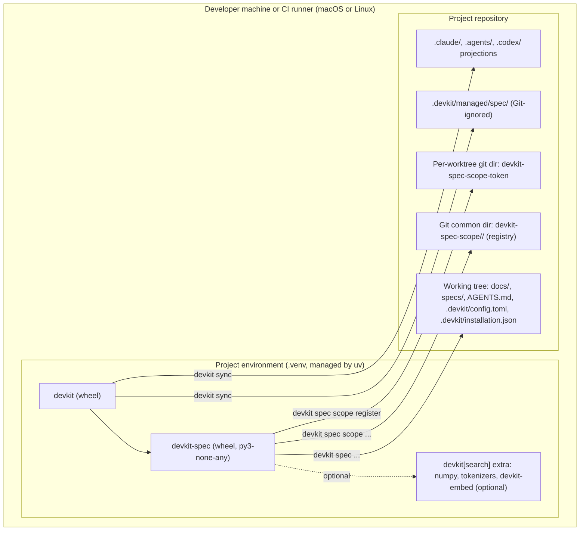

# [ARCH-07-deployment] Deployment View

- **arc42**: §7 Deployment View / C4 Model Deployment Diagram
- Containers deployed here: `ARCH-05-1-containers`. Contributor setup: [Local setup](../development/setup.md).

---

## 1. Deployment Topology

---

## 2. Installation in a Consumer Project

| Step | Command | Result |
| :--- | :--- | :--- |
| Install | `uv add --dev "devkit-spec @ git+https://github.com/mjkimR/devkit-spec"`; devkit and devkit-advisory follow through devkit-spec's Git sources (the private repository needs Git credentials: a credential helper, or a token given to Git through `GIT_CONFIG_*` environment variables) | Both packages in the project environment; `devkit spec` is available through `devkit.commands` |
| Dense search (optional) | `uv add --dev 'devkit-spec[search]'` | Adds `devkit[search]` (numpy, tokenizers, the `devkit-embed` model); `devkit spec search --mode auto` then ranks hybrid |
| Deploy | `uv run devkit sync` | The `core` preset of `spec` (declared `auto_select`) with devkit's own bundles; receipt in `.devkit/installation.json` |
| Docs skeleton (optional) | `uv run devkit add spec:docs-skeleton` | Seeds the `docs/` skeleton once where files are absent; the files are project-owned afterwards (`ADR-docs-skeleton-is-opt-in`) |
| Check | `uv run devkit spec --version` | `[VERSION: devkit-spec <version>]` |
| Opt out | `[presets] spec = false` in `.devkit/config.toml`, then `devkit sync` | The bundle is not deployed |

- Commands run in the project environment: `uv run devkit ...`. A `devkit` installed as a separate tool
  (`uv tool install devkit`) does not see devkit-spec.
- The deployed rule files import `devkit_spec`, so the package must be installed wherever `devkit rules check` runs,
  including the commit gate's environment and CI.
- devkit is pinned to a minor range (`devkit>=0.1,<0.2`); devkit-spec moves with devkit's minor versions.

### 2.1 Files on Disk

| Path | Written by | Owner |
| :--- | :--- | :--- |
| `.devkit/managed/spec/` (constitution, instructions, rules, templates, workflows, skills, subagents, playbooks, guidance) | `devkit sync` | devkit; never edited (changes go through `devkit override` or a project bundle) |
| `.claude/skills/spec*`, `.agents/skills/spec*`, `.claude/agents/`, `.agents/agents/`, `.codex/agents/` | `devkit sync` (projections) | devkit |
| `AGENTS.md` `DEVKIT:START/END` block (the `spec-pointer` line) | `devkit sync` | devkit; the rest of `AGENTS.md` is the project's |
| `docs/` skeleton files | `devkit add spec:docs-skeleton` (seeded once) | The project |
| `docs/proposals/`, `specs/`, `docs/decisions/`, `docs/materials/` | `devkit spec proposal ...`, `devkit spec new` | The project (committed) |
| `<git-common-dir>/devkit-spec-scope/<namespace>/` (`<task>.json`, `.lock`, `journal.jsonl`) | `devkit spec scope ...` | The registry; outside the working tree, shared by all worktrees |
| `<git-dir>/devkit-spec-scope-token` (mode 0600) | `devkit spec scope register`, handoff | One per worktree |

---

## 3. Development Environment

`pyproject.toml` takes `devkit` and `devkit-embed` from `https://github.com/mjkimR/devkit.git` as Git sources
(`[tool.uv.sources]`, subdirectories `packages/devkit` and `packages/devkit-embed`), pinned to a commit in `uv.lock`;
a contributor runs `just init` (`uv sync --no-active`). An unpushed devkit change is tried with
`just local-devkit <command>`, which overlays a checkout at `../devkit` for one run. The repository consumes its own `spec` bundle through the
editable install (`.devkit/config.toml`: `spec = ["core", "docs-skeleton"]`). Details: [Local setup](../development/setup.md),
[Development workflow](../development/workflow.md).

| Runtime | Requirement |
| :--- | :--- |
| Python | 3.12 or later (`.python-version`: 3.12) |
| Operating system | macOS or Linux; no Windows (`flock`) |
| Tools | `uv`, `just`, Git |

---

## 4. Continuous Integration

CI runs the same recipe as a contributor, `just ci` (lint check, Pyright, pytest, `devkit rules check`), in one Linux
job; devkit comes from the Git source in `uv.lock`. The repository is private, so the job avoids macOS runners. The job definition
is not checked into this repository (no `.github/workflows/`). Details: [CI](../development/ci-cd.md).

---

## 5. Secrets

devkit-spec reads and writes no secrets and needs no environment variables. `.env` files are never committed.
