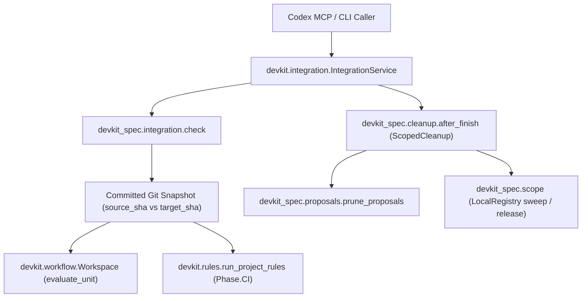

# Technical Plan: `SPEC-hook-driven-integration-cleanup` Approval-driven integration and worktree cleanup

## 1. Constitution & Invariant Review
None. The plan conforms to `CAP-DLV-delivery-workflows`, `CAP-DLV-project-policy`, `CAP-DLV-proposal-incubation`, `CAP-COLL-work-scope-registry`, `CAP-HARN-agent-guidance`, `ADR-integration-approval-asserted`, `ADR-cleanup-after-worktree-finish`, and `ADR-run-records-and-activity-branches`. All upstream imports use `devkit`'s public surface (`devkit.integration`, `devkit.worktree`, `devkit.workflow`, `devkit.rules`, `devkit.core`, `devkit.advisory`).

## 2. Architecture Overview & Impact
- **Impacted Components**:
  - `pyproject.toml` and `uv.lock`: Register `[project.entry-points."devkit.integration.readiness"] spec = "devkit_spec.integration"` and update `devkit-agt` / `devkit-advisory` lock revisions to the coordinated `devkit` release (`b510601d7cbee473d83a6a2403ad8e2b27b8910a`).
  - `src/devkit_spec/integration.py`: New SDD readiness provider implementing `check(context: IntegrationContext) -> Readiness` for Unit (`sdd-spec-feature`, `sdd-spec-bugfix`, `sdd-proposal`) and `session` (`sdd-session-feature`, `sdd-session-bugfix`) tasks.
  - `src/devkit_spec/cleanup.py`: Extend `after_finish` with `ScopedCleanup` attributes and methods (`integration_local_only = True`, `integration_plan`, `integration_validate`, `integration_run`) while preserving the classic `after_finish(base, result)` callable contract.
  - `.devkit/config.toml`: Configure `[integration]\nprovider = "spec"` for this repository.
  - `src/devkit_spec/bundle/skills/spec-integrate/SKILL.md`, `src/devkit_spec/bundle/skills/spec/references/worktree.md`, `src/devkit_spec/bundle/skills/spec/references/completion.md`: Document the approval-bound local integration path (`integration_prepare`, `integration_integrate`, `integration_status`, `integration_resume`) and `devkit worktree finish --local-only` within the 12,288-byte skill document budget.
  - `tests/test_integration.py`, `tests/test_cleanup.py`, `tests/test_package.py`: Unit and end-to-end integration tests for the readiness provider, scoped cleanup, and `IntegrationService` wiring.
- **New Dependencies**: None (`devkit-agt` already provides `devkit.integration`).

## 3. Component & Interface Design


### Data Contracts & Types
```python
from devkit.integration import (
    CleanupResult,
    CleanupTarget,
    Evidence,
    IntegrationContext,
    Readiness,
)
from devkit.worktree import FinishResult

# 1. Readiness Provider (src/devkit_spec/integration.py)
def check(context: IntegrationContext) -> Readiness:
    """Verify SDD completion readiness at context.finish.source_sha against target_sha."""

# 2. Scoped Post-Finish Cleanup on after_finish (src/devkit_spec/cleanup.py)
# CleanupTarget(kind="proposal-dir", identity="docs/proposals/PROP-<slug>", revision="empty-tree-v1")
# CleanupTarget(kind="scope-record", identity="<task_id>", revision="<namespace>:<revision>|base:<namespace>:<revision>")
after_finish.integration_local_only = True
def integration_plan(context: IntegrationContext) -> tuple[CleanupTarget, ...]: ...
def integration_validate(context: IntegrationContext, targets: tuple[CleanupTarget, ...]) -> None: ...
def integration_run(
    context: IntegrationContext, result: FinishResult, targets: tuple[CleanupTarget, ...]
) -> CleanupResult: ...
```

### Readiness Verification Rules (`src/devkit_spec/integration.py`)
1. **Materialized Committed Snapshot**:
   - Materialize `context.finish.source_sha` into a temporary workspace directory using `git_snapshot` / `materialize_snapshot` (comparing `context.finish.source_sha` against merge-base with `context.finish.target_sha`), so uncommitted edits in the worktree or base checkout never influence readiness.
   - Validate `[tool.spec]` (`read_spec_config`) and `[workflow.approvals]` (`check_approvals`) in both `base` and the materialized `source_sha` workspace.
2. **Unit Task (`task.kind == "unit"`)**:
   - Verify `context.finish.branch` (`plan-<slug>` or `dev-<slug>`) corresponds to `context.task.unit` via `attach_check(base, branch, unit, source_sha)`, and verify `context.task.id` matches `<slug>` or the unit's document ID (`PROP-<slug>` / `SPEC-<slug>`).
   - For a `dev-<slug>` branch, require a spec bundle bound to `sdd-spec-feature` or `sdd-spec-bugfix` (an un-handed-off proposal on `dev-<slug>` is not ready for Development merge). Evaluate the unit in the materialized `source_sha` workspace with `given=("dev-integration",)` and verify:
     - All pre-integration stages (`intent`, `specify` or `characterize`/`plan-tasks`/`reproduce`/`fix-verify`, `build-verify`, `review-refine`, `living-spec-draft`, `collect-feedback` when enabled, `final-change-report`, `integration-approval`) have passed (`current_stage == "integrate"`), with no unmet checks, no `blocked` problem or `pending_questions` hold, and `reconcile.md` `status: resolved` + `spec.md` `status: completed`.
     - If `spec.md` was handed off from a proposal (`decisions/02-gate-plan-accept.yaml` or carried `gate:plan-accept` decision present), verify `gate:plan-accept` is `accept`.
   - For a `plan-<slug>` branch, require `docs/proposals/PROP-<slug>` bound to `sdd-proposal` with `status: accepted`, `gate:plan-intent` and `gate:plan-accept` accepted, `collect-feedback` satisfied (unless `off`), `current_stage is None` (`complete=True`), and no envelope hold.
3. **Session Task (`task.kind == "session"`)**:
   - Require `dev-<slug>` branch (`plan-<slug>` is for proposal units only).
   - Verify no spec or proposal unit changed between `merge_base` and `source_sha` is incomplete or held.
   - Parse `context.task.claims_json` and verify structured session completion declarations: `task_kind` in `{"feature", "bugfix"}`, `effort` in `{"low", "medium", "high"}`, `review` (`"passed"` or `True`), `tests` (`"passed"` or `True`), `lint` (`"passed"` or `True`), and when `task_kind == "bugfix"`, `reproduced` is `True` and `resolved` is `True`.
4. **Cumulative `Phase.CI` Governance Rules**:
   - Run `run_project_rules(materialized_root, snapshot=ci_snapshot, phase=Phase.CI)` on the committed `source_sha` vs `merge_base(target_sha, source_sha)` snapshot and require zero load/evaluation errors and zero blocking violations (`lint-ci-clean`).

### Scoped Cleanup Rules (`src/devkit_spec/cleanup.py`)
1. **Non-spec repository**: When `(base / ".devkit/managed/spec").is_dir()` is false, `integration_plan` returns `()`, `integration_validate` is a no-op, and `integration_run` returns `CleanupResult(done=True, notices=())`.
2. **Target planning (`integration_plan`)**:
   - **Proposal remnant target**: If `docs/proposals/PROP-<slug>` exists in `base` (and is either already empty or deleted by `source_sha`), include `CleanupTarget(kind="proposal-dir", identity=f"docs/proposals/PROP-{slug}", revision="empty-tree")`.
   - **Scope record target(s)**: Open the scope registry session at `base`. For a `--no-worktree` task (`Path(context.finish.path).resolve() == base.resolve()`), if the base checkout holds its own registered record (`own(session)`), include `CleanupTarget(kind="scope-record", identity=record.task_id, revision=f"base:{namespace}:{record.revision}")`. For a linked worktree, query `session.registry.query(namespace, session.deadline)` and include `CleanupTarget(kind="scope-record", identity=record.task_id, revision=f"worktree:{namespace}:{record.revision}")` for each record whose resolved `worktree` equals `Path(context.finish.path).resolve()`.
3. **Target validation (`integration_validate`)**:
   - Verify no target has an unknown `kind`.
   - For `"proposal-dir"`, verify `identity == f"docs/proposals/PROP-{slug}"` and, if the directory still exists in `base`, it is not a symlink escaping the workspace.
   - For `"scope-record"`, read current records for the finished worktree (or base token). If an approved record still exists, its `revision` and `namespace` must match the approved `CleanupTarget.revision` (otherwise raise `StaleRequestError`); if it is already absent, allow it so `integration_resume` succeeds after partial completion. If an unapproved record now exists for the finished worktree, raise `StaleRequestError`.
4. **Target execution (`integration_run`)**:
   - Process only the approved `targets` tuple in order.
   - For `"proposal-dir"`, run `prune_proposals(base, slug)` and emit `PostFinishNotice` for removed directories, or `ProposalCleanupWarning` with `done=False` on `OSError`.
   - For `"scope-record"`, remove only the approved `task_id` at its approved revision (via `release` for `"base:..."` or `registry.sweep(namespace, True, {task_id: rev}, deadline, only={task_id})` for `"worktree:..."`), converting string notices to `PostFinishNotice(line, "extension: spec")` and returning `done=False` if any approved record failed to remove or timed out.

## 4. Error Handling & Edge Cases
- **Unmet readiness vs provider crash**: Expected policy/config/workflow/rule problems on the branch are returned as `Readiness(source_sha, target_sha, evidence=..., reasons=...)` so `IntegrationService` raises `INTEGRATION_NOT_READY` with every reason preserved, rather than masking them as an unexpected exception.
- **Deterministic recheck before merge**: `Evidence` values use only deterministic strings (`source_sha`, `target_sha`, unit path, workflow ID, check counts, normalized claim summary) so `providers.check(provider, request.context) == request.readiness` holds on pre-merge revalidation.
- **Partial post-finish failure and resume**: If `prune_proposals` or scope sweep fails during `integration_run`, `CleanupResult(done=False, notices=...)` marks `post_finish` as `failed` (`status="partial"`, `INTEGRATION_CLEANUP_INCOMPLETE`) while preserving the completed Git merge, worktree removal, and branch deletion; calling `integration_resume(request_id)` after fixing the filesystem/lock issue re-validates (allowing already-completed targets) and completes the remaining target.

## 5. Verification & Test Plan
- **Unit & Integration Tests**:
  - `tests/test_integration.py`: Unit and `IntegrationService` end-to-end tests covering completed `sdd-spec-feature`, `sdd-spec-bugfix`, and `sdd-proposal` units, incomplete stages, held envelopes, `Phase.CI` rule violations, valid and invalid `session` claims, non-approval (`approve=False`, `decline`, `cancel`), stale scope invalidation, `delete_branch=false`, `pull_request="required"`, and zero network calls.
  - `tests/test_cleanup.py`: Classic `after_finish` tests plus `ScopedCleanup` (`integration_plan`, `integration_validate`, `integration_run`) tests including revision drift rejection and partial cleanup resume.
  - `tests/test_package.py` and `tests/test_bundle_budgets.py`: Verify `devkit.integration.readiness` entry point registration and skill document byte budgets.
- **Validation Commands**:
  - `just lint-check`
  - `just check`
  - `just test`
  - `just rules-check`
  - `just ci`
