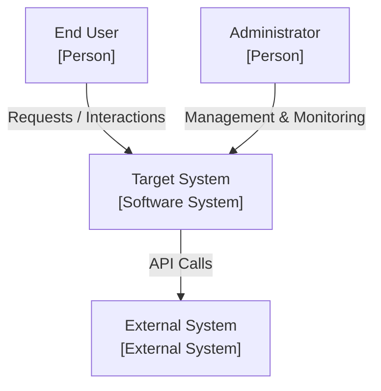

# [ARCH-03-context] System Scope and Context

- **arc42**: §3 System Scope and Context / C4 Model Level 1 (System Context)
- Background, goals, and stakeholders reside in `ARCH-01-introduction-and-goals`.

---

## 1. C4 Level 1: System Context Diagram
<!-- High-level relationships between system boundaries, actors, and external systems -->

---

## 2. External System Interfaces
| External System | Protocol | Data Format | Integration Purpose | Fallback Strategy |
| :--- | :--- | :--- | :--- | :--- |
| <!-- System Name --> | HTTPS / REST | JSON | <!-- Purpose --> | <!-- Failure handling policy --> |
