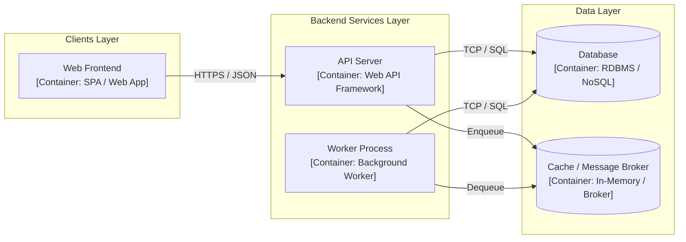

# [ARCH-05-1-containers] Containers View

- **arc42**: §5 Building Block View, Level 1 / C4 Model Level 2 (Container)

---

## 1. C4 Level 2: Container Diagram
<!-- High-level deployable execution units (Web App, API Server, Worker, Database) and communication protocols -->

---

## 2. Container Inventory & Technology Stack
| Container | Role & Responsibilities | Technology Stack | Deployment Runtime |
| :--- | :--- | :--- | :--- |
| **`web`** | User interface presentation | <!-- e.g., Svelte 5 / React / Vue --> | Static Hosting / CDN |
| **`api`** | Business logic & API serving | <!-- e.g., Go / Python FastAPI / Node --> | Container (Docker / Cloud Run) |
| **`worker`** | Asynchronous background processing | <!-- Tech stack --> | Background Worker |
| **`db`** | Persistent relational data store | <!-- e.g., PostgreSQL / MySQL --> | Managed Database |
| **`cache`** | In-memory cache & message broker | <!-- e.g., Redis --> | Managed In-Memory Store |

---

## 3. Inter-Container Communication & Contracts
- **Client <-> API Server**: RESTful API / GraphQL (OpenAPI contract), Bearer Token authentication.
- **API Server <-> Database**: Connection pooling, ORM or query builder.
- **API Server <-> Worker**: Async task queue or pub/sub messaging.
