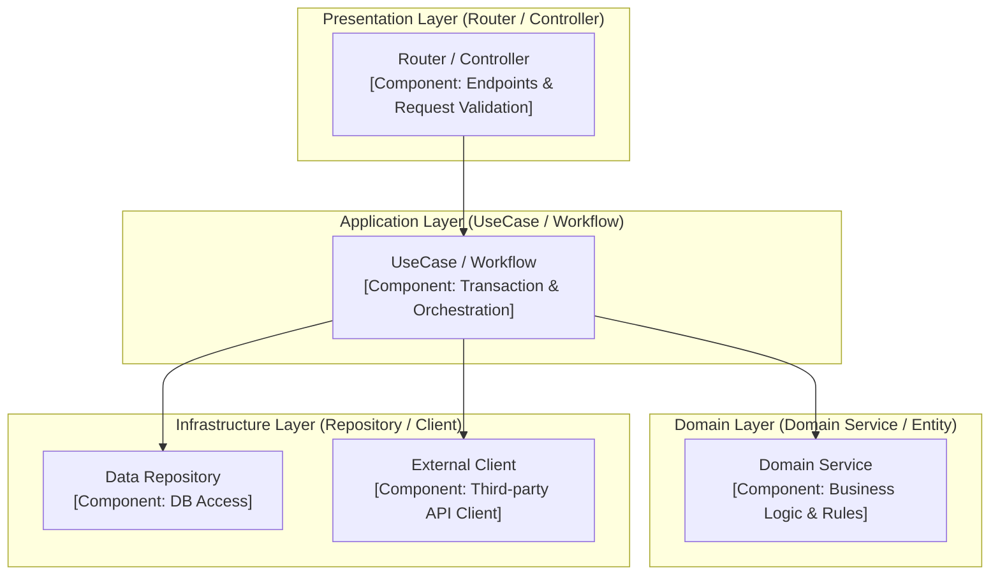

# [ARCH-05-2-components] Components View

- **arc42**: §5 Building Block View, Level 2 / C4 Model Level 3 (Component)

---

## 1. C4 Level 3: Component Diagram
<!-- Internal layers, modules, and component interactions within key containers (e.g., API Server) -->



---

## 2. Layered Architecture Invariants
Preserve separation of concerns across architectural layers:

1. **Presentation (Router / Controller)**:
   - Request payload validation, HTTP status mapping, dependency injection.
   - Business logic and direct database queries are prohibited (`MUST NOT`).
2. **Application (UseCase / Workflow)**:
   - Use case orchestration, transaction boundaries (Commit / Rollback).
   - Protocol-agnostic logic decoupled from HTTP frameworks (`SHOULD`).
3. **Domain (Domain Service / Entity)**:
   - Pure business rules and domain invariants independent of external infrastructure.
4. **Infrastructure (Repository / Client)**:
   - Concrete implementations for persistence, cache, and external third-party communication.

---

## 3. Codebase Directory Mapping
```text
src/
├── api/             # Routers, Middlewares, Handlers
├── features/        # Feature/domain modules (UseCases & Services)
└── infrastructure/  # DB Repositories, External Clients, Config
```
