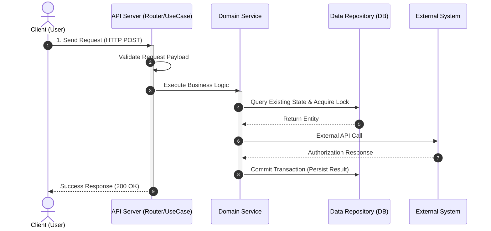
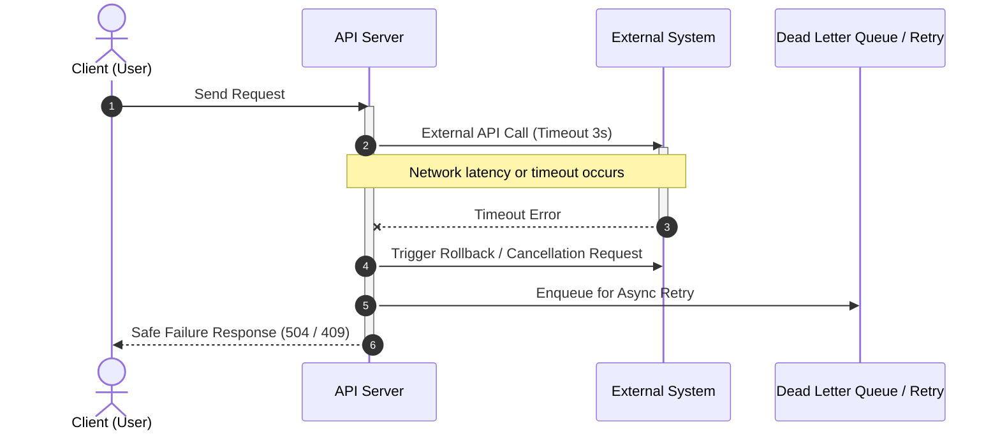

# [ARCH-06-runtime-view] Runtime View

- **arc42**: §6 Runtime View

---

## 1. Overview
Dynamic collaborative behavior showing how static structural components (Containers, Components) interact over time to execute concrete business scenarios.

---

## 2. Core Runtime Scenario 1: [Happy Path Business Flow]
<!-- Sequence diagram for the primary representative use case (e.g., checkout/payment authorization, user registration) -->

---

## 3. Core Runtime Scenario 2: [Exception / Fault Recovery Flow]
<!-- Sequence diagram for timeouts, third-party outages, or concurrency rollbacks -->

---

## 4. Concurrency Control & Delivery Guarantees
1. **Concurrency Control Strategy**: <!-- e.g., Optimistic Locking via Version column, or Pessimistic Locking (SELECT FOR UPDATE) -->
2. **Message Delivery Guarantees**: <!-- e.g., At-least-once delivery with consumer idempotency enforcement -->
