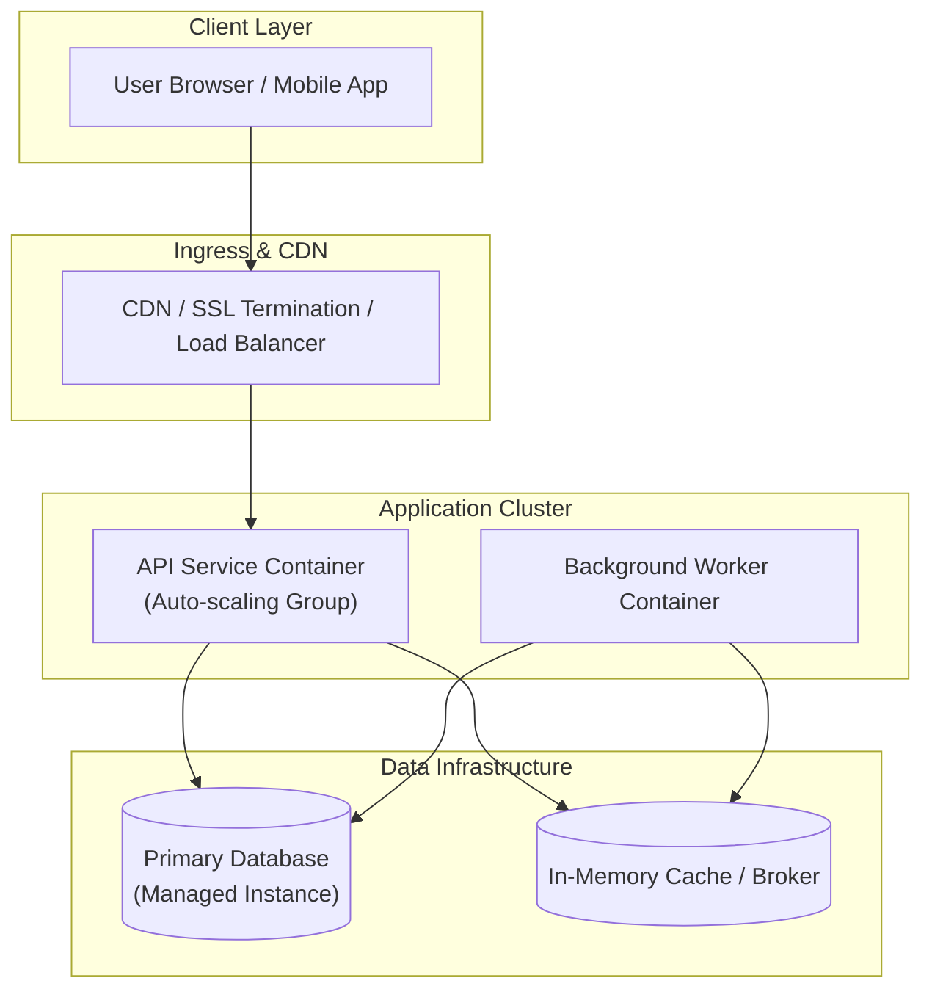

# [ARCH-07-deployment] Deployment View

- **arc42**: §7 Deployment View / C4 Model Deployment Diagram

---

## 1. Deployment Topology
<!-- Infrastructure layout, subnets, load balancers, and compute resource configuration for staging and production -->

---

## 2. Infrastructure Inventory by Environment
| Environment | Compute Platform | Database | Domain / Host Address |
| :--- | :--- | :--- | :--- |
| **Local** | Docker Compose / Local Host | Local Container | `localhost:8000` |
| **Staging** | <!-- Staging compute platform --> | <!-- Staging DB instance --> | <!-- Staging URL --> |
| **Production** | <!-- Production compute platform --> | <!-- Production DB instance --> | <!-- Production URL --> |

---

## 3. Secrets Management & Environment Variables
1. **Never Commit Secrets to Codebase**: API keys and DB credentials must never be committed to Git (`MUST NOT`).
2. **Secret Providers**: Inject secrets securely at runtime via cloud secret managers (AWS Secrets Manager, GCP Secret Manager, Vault).
3. **Local Development**: Use `.env.local` ignored by `.gitignore`.
