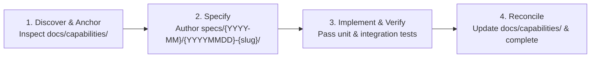

# Development Workflow & Collaboration Guide

Standard procedures for team members and AI coding agents when authoring, verifying, and submitting code.

---

## 1. Branching Strategy
- **`main`**: Production-ready stable branch. Direct commits are forbidden (`MUST NOT`); merges occur strictly via Pull Requests.
- **Working Branches**:
  - `feat/<issue-id>-<description>`: New feature development
  - `fix/<issue-id>-<description>`: Bug fixes
  - `refactor/<description>`: Code refactoring
  - `docs/<description>`: Documentation changes

---

## 2. Spec-Driven Development (SDD) Lifecycle

This project couples the **Living Spec model** with **feature specs** to maintain specification freshness. All development work adheres to four core stages:



1. **Step 1: Discover & Anchor**
   - Identify the functional domain and capabilities in `docs/capabilities/` and `docs/stories/`.
2. **Step 2: Specify in `specs/`**
   - Scaffold the task specification (`spec.md`), technical plan (`plan.md`), and task checklist (`tasks.md`) under `specs/{YYYY-MM}/{YYYYMMDD}-{feature-slug}/`.
   - Anchor links to corresponding `docs/capabilities/` and `docs/stories/`.
3. **Step 3: Implement & Verify**
   - Implement code following `tasks.md` boundaries and ensure tests pass.
4. **Step 4: Reconcile Living Spec & Complete**
   - Update `docs/capabilities/<area>/<capability>.md` with modified business rules, contracts, and error policies.
   - Record significant technical or structural decisions in `docs/decisions/` as ADRs.
   - Seal the bundle with `reconcile.md` upon completion. `docs/` remains the single source of truth.

---

## 3. Commit Message Conventions
Follow Conventional Commits format in the imperative mood without emojis:

```text
<type>(<scope>): <subject>

[optional body]

[optional footer(s)]
```
- **Type**: `feat`, `fix`, `docs`, `style`, `refactor`, `test`, `chore`
- **Examples**:
  - `feat(billing): add kakao pay confirmation handler`
  - `docs(capabilities): update idempotency policy for payment api`
  - `fix(auth): prevent token refresh race condition`

---

## 4. Pull Request Rules
- Open PRs only after passing local linting, type checking, and tests.
- PR titles follow Conventional Commits.
- Fill out PR templates with description of changes, linked specs/stories, and test evidence.
