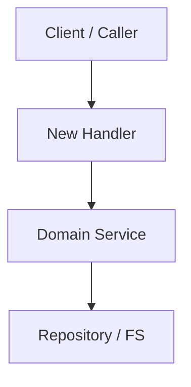

# spec-plan: Technical Planning Workflow

Use this skill after a specification (`specs/<YYYY-MM>/<YYYYMMDD>-<slug>/spec.md`) has been drafted and agreed upon: the `specify` stage of workflow `direct-delivery`, or the `plan-tasks` stage (fix design) of workflow `bugfix`. The goal is to design the technical solution, map changes to codebase architecture, identify data contracts, and establish technical boundaries before generating tasks.

---

## 1. Prerequisites & Inputs

- A validated specification at `specs/<YYYY-MM>/<YYYYMMDD>-<slug>/spec.md`; `plan.md` beside it is the skeleton `devkit spec new` or `devkit spec proposal handoff` wrote.
- System architecture documentation at `docs/architecture/` (e.g., arc42, C4 diagrams).
- Existing capability definitions at `docs/capabilities/` (`devkit spec list capability`).
- Architecture Decision Records at `docs/decisions/` (`devkit spec list decision`).

---

## 2. Planning Workflow

### Step 0: Constitution & Invariant Pre-Flight
- Check the plan against the Living Spec and the spec constitution (`devkit get-context spec`):
  - `docs/decisions/` (ADRs): Does this plan violate any accepted ADR? (`devkit spec search "<topic>" --kind decision`)
  - `docs/architecture/`: Does this plan violate module boundaries, import hierarchies, or tech stack constraints (e.g., runtime, packaging or dependency constraints the architecture documents declare)?
  - `docs/capabilities/`: Does this duplicate or break existing living capabilities? (`devkit spec refs <CAP-ID> --direction in` shows what depends on one.)
- If an architectural rule MUST be modified or overridden:
  - Document the reason explicitly and propose drafting a new ADR at `docs/decisions/<YYYY-MM>/<YYYYMMDD>-<slug>.md` (ID `ADR-<slug>`, template `.devkit/managed/spec/templates/decision.md`).
  - A new policy or design choice outside the approved scope returns to the `direction` gate (`devkit workflow return --unit <dir> --to direction --note "<choice>"`); a bugfix whose fix needs a different defect scope returns to `characterize`.

### Step 1: Component Breakdown & Interface Contracts
- Identify which packages, modules, or services will be touched or introduced.
- Define internal contracts (data structures, interfaces, function signatures, database schemas).
- For external APIs or CLI interfaces, specify input flags, return codes, and payload formats.

### Step 2: Cross-Artifact Consistency Check
- Cross-audit `spec.md` and the emerging `plan.md`:
  - Does every User Story in `spec.md` have a corresponding implementation path in `plan.md`?
  - Does every `[AC-NN]` scenario (happy path + edge cases) have a designated handling component?
  - Are all Non-Goals in `spec.md` left out of the plan?

### Step 3: Failure Modes, Edge Cases & Rollback Strategy
- What happens on network failure, partial writes, or corrupt configuration?
- How is idempotency preserved?
- Are migrations required? If yes, is there a backwards-compatible rollout plan?

### Step 4: Verification & Test Strategy
- Unit tests: Mock boundaries and pure logic tests.
- Integration tests: End-to-end execution, CLI command tests, or contract validation.
- Static analysis: Linter rules, type checking, or schema validators to enforce.
- For a bugfix: the reproduction test that becomes the regression test, and the checks that cover the preserved behavior.

---

## 3. Plan Output Standard

Rewrite `specs/<YYYY-MM>/<YYYYMMDD>-<slug>/plan.md`, keeping its `id` and `spec` frontmatter. The invariant review, impacted components and verification sections are always present; the others (diagram, data contracts, storage, failure modes) are written only when the change has that content. Drop a section that does not apply instead of writing "N/A"; a small change can have a short plan. Cite documents by full ID in backticks (`` `ADR-<slug>` ``, `` `CAP-<AREA>-<slug>` ``), never by Markdown path.

````markdown
---
id: PLAN-<feature-slug>
spec: SPEC-<feature-slug>
---

# Technical Plan: `SPEC-<feature-slug>` <Feature Title>

## 1. Constitution & Invariant Review
<List only conflicts with ADRs, architecture constraints or existing capabilities, and the ADR each one needs. Write "None" when the plan conforms.>

## 2. Architecture Overview & Impact
- **Impacted Components**:
  - `path/to/component-a`: <What changes>
  - `path/to/component-b`: <What changes>
- **New Dependencies**: <None or specific libraries with rationale>

## 3. Component & Interface Design


### Data Contracts & Types
```python
# or a snippet in the project's language specifying the normative interface
@dataclass(frozen=True)
class FeatureConfig:
    enabled: bool
    timeout_ms: int
```

## 4. Storage & State Management
<Schema changes, persistence layer, or file formats.>

## 5. Error Handling & Edge Cases
- **Failure Scenario 1**: <Mitigation>
- **Failure Scenario 2**: <Mitigation>

## 6. Verification & Test Plan
- Unit test coverage targets.
- Integration test scenarios.
- Commands to run for validation (`just test`, `just lint`, `devkit rules check`, etc.).
````

---

## 4. Definition of Done (DoD) for Planning
- [ ] Pre-flight constitution check verified against `docs/decisions/` and `docs/architecture/`.
- [ ] Every user story and scenario in `spec.md` has an implementation path; non-goals stay out of the plan.
- [ ] Sections that do not apply are omitted.
- [ ] Affected packages, modules, and interfaces are explicitly enumerated.
- [ ] Testing strategy and validation commands are clearly defined.
- [ ] File is saved at `specs/<YYYY-MM>/<YYYYMMDD>-<slug>/plan.md`.
- [ ] The skeleton marker line `<!-- devkit:skeleton -->` is removed from `plan.md` (`not-skeleton(plan.md)` keeps the stage open until then).
- [ ] Ready to proceed to `spec-tasks`.
